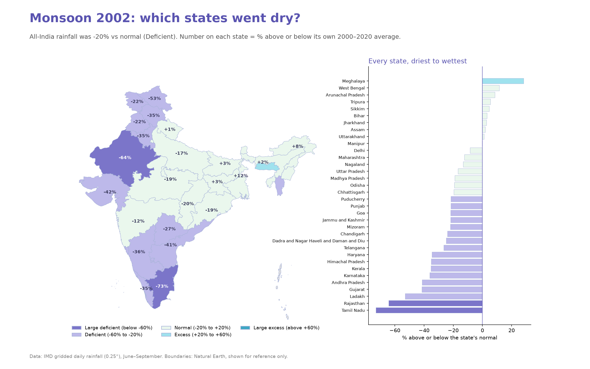
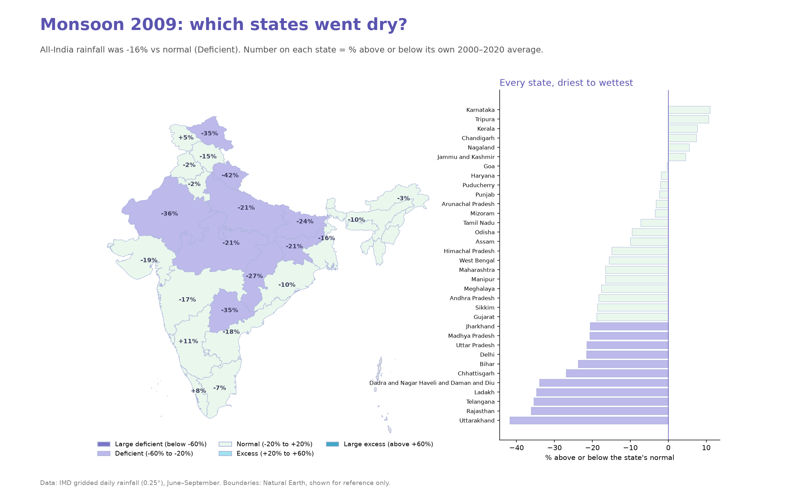
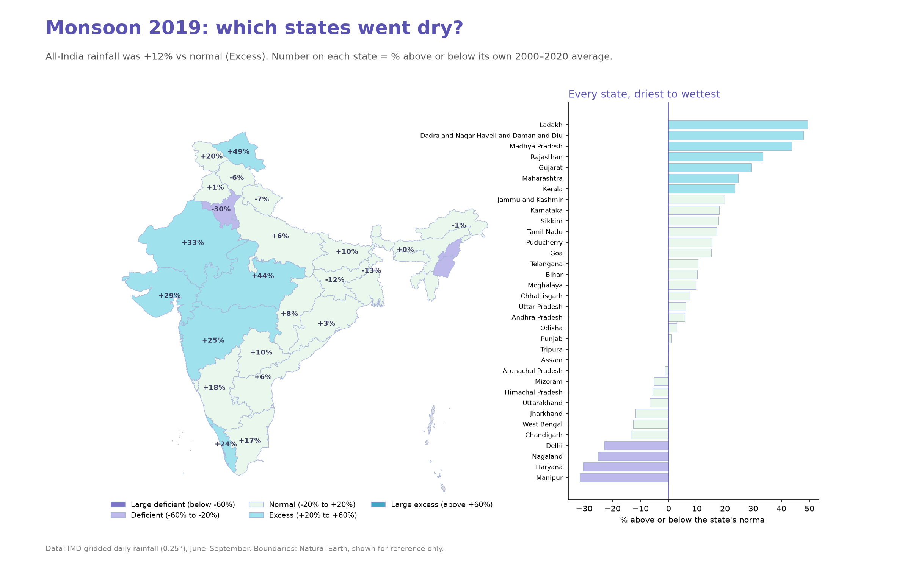
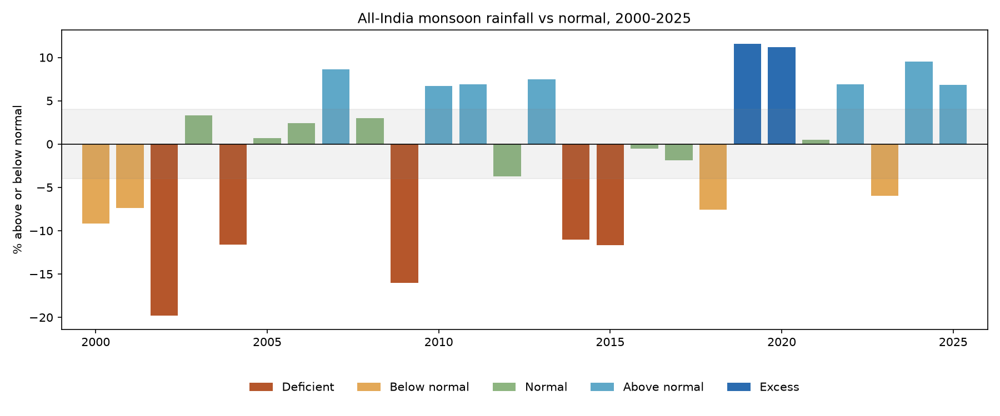
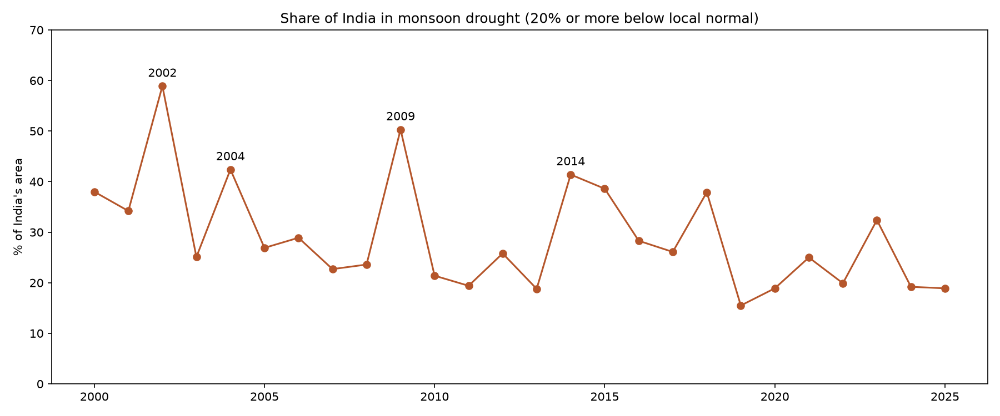

# India Monsoon & Drought Dashboard (2000–2025)

An interactive dashboard that uses **official IMD daily rainfall data** to find India's monsoon droughts:
which years failed, how much of the country was affected, and which states were hit hardest.

**Live demo:** [Open the app](LIVE-LINK-HERE)



## Key findings
- **2002 was the worst monsoon of the century:** rainfall was about 20% below normal and **59% of India's area** was in drought.
- **2009** was the second worst (−16%, **50%** of India in drought), followed by the back-to-back droughts of **2014 and 2015**.
- **Droughts look different each time.** In 2002 the deficit was concentrated in Rajasthan, Gujarat and Tamil Nadu; in 2009 it covered most of north and central India.
- **Recent monsoons have mostly been wet:** 5 of the last 7 (2019–2025) were above normal or in excess. Seven years is too short to call this a long-term trend.

| | | |
|---|---|---|
|  |  |  |




## Data
- **Rainfall:** India Meteorological Department (IMD) gridded daily rainfall, 0.25° (~25 km), 2000–2025, downloaded with [`imdlib`](https://imdlib.readthedocs.io).
- **State boundaries:** Natural Earth, shown for reference only.

## Method
1. Add up daily rainfall into monthly totals, then June–September (monsoon) totals for every grid square.
2. **All-India:** area-weighted average of all grid squares, compared with IMD's long-period average (868.6 mm) and classified with IMD's categories.
3. **Drought area:** share of India's grid squares that got 20% or more below their own 2000–2020 average.
4. **States:** a spatial join finds which state each grid square lies in; the state value is the average of its squares.

## How I checked the results
- The method picks out India's known drought years (2002, 2009, 2014, 2015) and wet years (2019, 2020).
- Yearly totals are close to IMD's published figures (for example 969 mm for 2019, against IMD's ~968 mm). Departures differ by a few points (2009: −16% here, about −22% officially), because IMD averages over its 36 subdivisions while this project averages over grid squares.

## Limitations
- "Normal" for drought area and states is the 2000–2020 average, not IMD's official 1971–2020 normal.
- Tamil Nadu gets most of its rain from October to December, so a dry June–September affects it less than the numbers suggest.
- State averages hide variation within large states.

## Run it yourself

```
pip install -r requirements.txt
streamlit run app.py
```
The dashboard only needs the small files in `data/`. To rebuild everything from raw IMD data (~600 MB):
```
pip install -r requirements-analysis.txt
python test_download.py      # download IMD daily rainfall, 2000–2025
python prepare_data.py       # daily → monthly totals
python monsoon_summary.py    # all-India table
python charts.py             # charts
python state_map.py          # state maps (change YEAR inside)
```

## Future work
- Add recent weeks using IMD's real-time rainfall data.
- District-level maps, and the October–December northeast monsoon for south India.

## Tech
Python, xarray, pandas, geopandas, matplotlib, Plotly, Streamlit. Animated clouds and rain are drawn with SVG and CSS.
